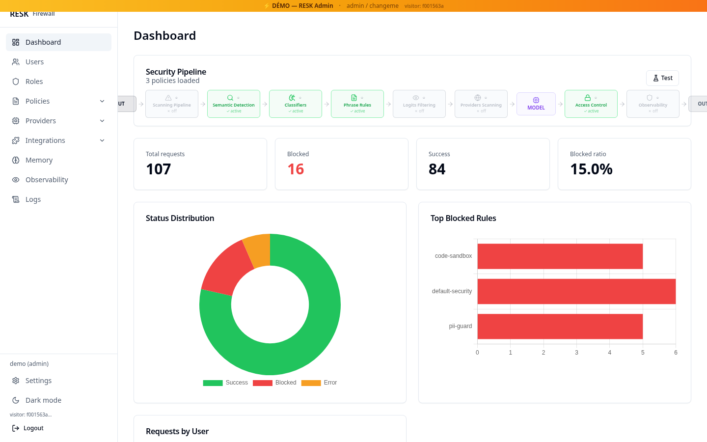
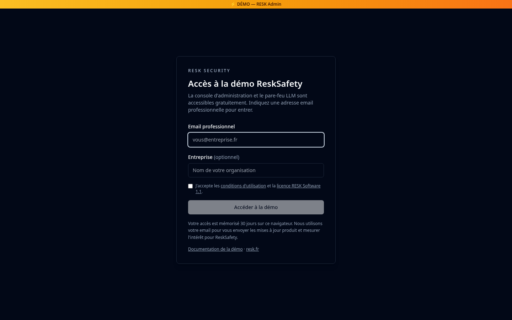

# RESK Demo — ReskSafety en ligne

[](https://demo.resk.fr)

[](https://demo.resk.fr)

**Démo : [demo.resk.fr](https://demo.resk.fr)** · **Documentation : [resk.fr/fr/docs/demo](https://resk.fr/fr/docs/demo/)** · **Site : [resk.fr](https://resk.fr)**

Ce dépôt public documente et distribue le kit de la démo hébergée **ReskSafety** : accès protégé par email, identifiants de démonstration, parcours guidé, capture d'écran et fichiers de déploiement. Le code source complet de l'application est privé ; il est disponible pour les clients, évaluateurs et partenaires sur demande.

---

## Accès / Access

1. Ouvrez **[demo.resk.fr](https://demo.resk.fr)**.
2. Saisissez une adresse email professionnelle et acceptez les conditions.
3. La barrière dépose un cookie `HttpOnly` valable **30 jours**.
4. La console d'administration s'ouvre avec le compte de démonstration.

> La démo est réinitialisée régulièrement. N'y saisissez aucune donnée réelle, aucun secret et aucune clé API de production.

### Identifiants / Credentials

| Compte | Mot de passe | Rôle |
|---|---|---|
| `admin` | `changeme` | Administrateur complet |
| `demo` | `demo1234` | Compte de démonstration (connexion auto) |
| `alice`, `bob`, `carol`, `dave` | `demo1234` | Rôles non administrateurs, bitmasks différents |

Ces identifiants sont publics et volontairement faibles. Ne les réutilisez jamais hors de la démo.

## Ce qu'il faut essayer / What to try

- **Tableau de bord** — pipeline de sécurité, compteurs, taux de blocage.
- **Politiques** — phrases interdites, motifs de jailbreak, niveaux de scan, règles de logits, prévisualisation avant sauvegarde.
- **Rôles & utilisateurs** — activer/désactiver les bits du masque 64 bits et observer les permissions effectives.
- **Fournisseurs** — ajouter un endpoint compatible OpenAI, tester la connexion, router avec `X-Provider-Id`.
- **Journaux & observabilité** — requêtes, sessions, appels d'outils, piste d'audit.
- **API pare-feu** — `POST /v1/chat/completions` avec un JWT de démo.

## Auto-hébergement / Self-hosting

Le kit de déploiement de la démo est fourni ici :

- [`docker-compose.demo.yml`](docker-compose.demo.yml) — stack SQLite + Traefik pour `demo.resk.fr`
- [`frontend/nginx.demo.conf`](frontend/nginx.demo.conf) — en-têtes de sécurité, proxy `/api/` et `/v1/`

L'application complète (FastAPI + React) est distribuée sous licence commerciale. Pour obtenir le code source, une évaluation ou un devis :

**contact@resk.fr** — [resk.fr/contact.html](https://resk.fr/contact.html)

Les variables sensibles (`RESEND_API_KEY`, `NOTIFY_EMAIL`, secrets JWT) ne sont **jamais** versionnées. Utilisez un fichier `.env` local ou les secrets de votre orchestrateur.

```bash
# Exemple de déploiement (une fois le code source obtenu)
git clone <votre-acces> ReskSafety
cd ReskSafety
docker compose -f docker-compose.demo.yml up -d --build
```

## Licence / License

**RESK Software License 1.1** — voir [`LICENSE`](LICENSE).

- Les **personnes physiques** peuvent étudier, évaluer et utiliser le logiciel à des fins personnelles, éducatives et de recherche académique.
- Toute utilisation par une **entité professionnelle** — évaluation interne, production, SaaS, conseil, revente — nécessite une **licence commerciale** et, le cas échéant, des royalties.
- Contact : **contact@resk.fr**.

Ce dépôt ne contient pas le code source de l'application ; il documente la démo publique et son kit de déploiement. Les marques et le nom RESK restent la propriété de RESK Security.

---

## English summary

**Live demo:** [demo.resk.fr](https://demo.resk.fr) — full ReskSafety admin console with seeded users, policies and logs. Access is free but gated by a professional email; the gate sets a 30-day `HttpOnly` cookie. Demo credentials are `admin` / `changeme` and `demo` / `demo1234`.

This repository holds the public demo documentation, screenshot and deployment kit (Docker Compose + nginx config). The full application source is private and available to customers and evaluators on request at **contact@resk.fr**. The project is licensed under the **RESK Software License 1.1**: free for natural persons for personal, educational and academic research; professional use requires a commercial license.

---

*RESK Security — bâtir des applications IA sécurisées pour l'entreprise.*
